<!-- cards:start -->

<picture>
<source media="(prefers-color-scheme: dark)" srcset="cards/heading-coding-dark.svg">

</picture>

<a href="https://madhavpanchal.com/">madhavpanchal.com</a> / <a href="https://www.linkedin.com/in/madhavpanchal/">linkedin</a> / <a href="mailto:madhavpanchal1716@gmail.com">email</a>

<!-- cards:end -->
